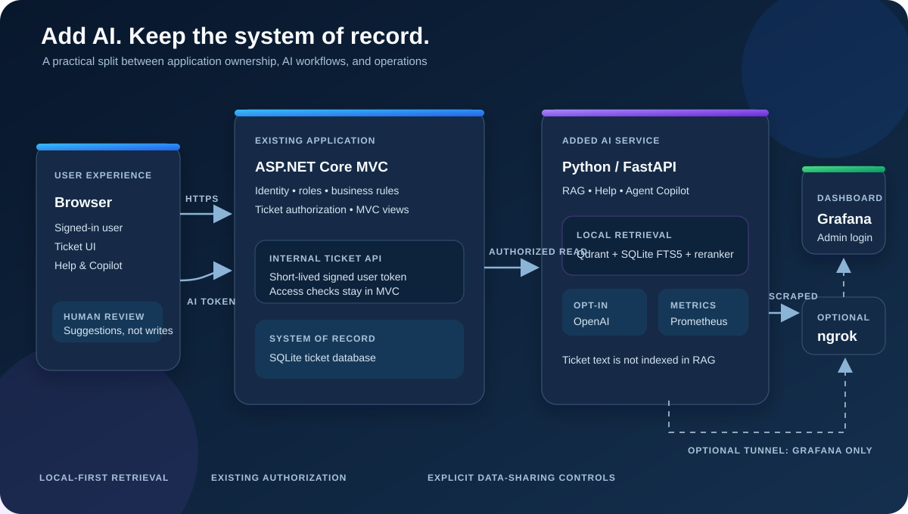
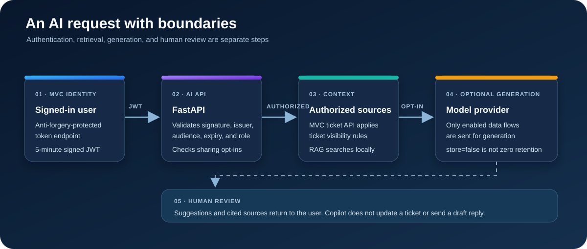
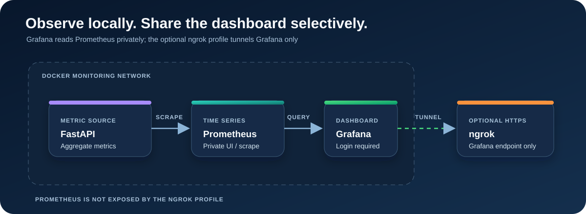

# Adding AI to an Existing ASP.NET Core MVC Application

## A practical architecture with a Python AI service, secure ticket access, RAG, and operational dashboards

AI features do not require replacing a mature web application or moving its data into a new platform. In this project, an existing ASP.NET Core MVC ticketing application remains responsible for users, roles, permissions, and ticket records. A separate Python/FastAPI service adds knowledge search, AI assistance, and an agent copilot.

The separation is deliberate: the MVC application stays the system of record, while the AI service receives only the data it needs for a specific, authorized request.



## Start with the application you already have

The MVC application already handles the everyday ticket workflow: requesters create and track their own tickets, while support staff can manage the wider queue. Its controllers and ASP.NET Identity roles continue to enforce those rules.

The AI service is an addition, not a second ticket application:

- **ASP.NET Core MVC** owns authentication, authorization, ticket business rules, and the SQLite ticket database.
- **FastAPI** handles AI-facing HTTP endpoints, retrieval orchestration, and model integration.
- **Qdrant and SQLite FTS5** search the knowledge base locally using vector and lexical retrieval.
- **OpenAI** is an optional generation provider, controlled by separate configuration switches.
- **Prometheus and Grafana** provide operational metrics and dashboards.

This pattern also applies to an existing CRM, service portal, or internal operations tool: keep ownership of business data in the application that already understands its permissions, and add AI through a narrow service boundary.

## A short-lived token connects the two applications

The browser is signed in to MVC with the application's normal authentication cookie. When the AI UI needs to call FastAPI, it requests a short-lived access token from `AiSessionController`.

The controller builds the token from the authenticated user and their MVC roles:

```csharp
var claims = new List<Claim>
{
    new("sub", userId),
    new("name", User.Identity?.Name ?? string.Empty)
};
claims.AddRange(roles.Select(role => new Claim("role", role)));

var token = new JwtSecurityToken(
    issuer: "service-desk-main-app",
    audience: "service-desk-agentic-app",
    claims: claims,
    notBefore: DateTime.UtcNow,
    expires: DateTime.UtcNow.AddMinutes(5),
    signingCredentials: new SigningCredentials(key, SecurityAlgorithms.HmacSha256));
```

In [`main-app/Controllers/AiSessionController.cs`](main-app/Controllers/AiSessionController.cs), the token endpoint is authenticated and protected by MVC's anti-forgery validation. FastAPI checks the signature, issuer, audience, and expiry in [`agentic-app/auth.py`](agentic-app/auth.py). A five-minute lifetime limits how long a copied token remains useful.

This is not a replacement for authorization. It is a signed way for the AI service to learn which MVC user and roles made the request.

## Keep ticket access behind MVC

FastAPI does not connect directly to the MVC database. When it needs ticket context, it calls MVC's internal API with the user's token. The internal endpoint validates that token and applies ticket visibility rules before returning data.

For example, the search action restricts non-staff users to tickets they created:

```csharp
if (!User.IsInRole("Agent") && !User.IsInRole("Admin"))
{
    var requesterId = User.FindFirst("sub")?.Value;
    tickets = tickets.Where(ticket => ticket.CreatedById == requesterId);
}
```

That code lives in [`main-app/Controllers/InternalTicketsController.cs`](main-app/Controllers/InternalTicketsController.cs). The AI service calls it through [`agentic-app/ticket_tools.py`](agentic-app/ticket_tools.py), forwarding the signed bearer token rather than creating a second, more privileged identity.

The result is a useful boundary: MVC remains the place where ticket access is decided, and the AI service cannot bypass the application's existing data rules.

## Add AI features as explicit workflows

The project offers two distinct experiences rather than a single opaque chatbot:

1. **Agent Copilot** takes a ticket number, retrieves the ticket the signed-in agent is authorized to see, and returns a summary, suggested category and priority, missing information, and a draft reply. It does not update the ticket or send the reply.
2. **AI Help** takes a written question and a selected source: the knowledge base, the user's visible tickets, or web search.

The difference matters. A copilot can be designed as a reviewable suggestion in an existing workflow, while a conversational help feature can be treated as a separate user-initiated request.



For ticket analysis, [`agentic-app/main.py`](agentic-app/main.py) checks that the user is an Agent or Admin and that ticket sharing is explicitly enabled. The prompt contains the ticket title, description, category, priority, and status; the ticket number is used to retrieve the record, not included in the model input. The model's structured response is displayed for a person to review.

The AI should assist a decision-maker, not silently take a business action. In this implementation, accepting a suggestion and changing a ticket remain explicit human actions in MVC.

## Use retrieval for knowledge-grounded answers

A language model by itself does not know an organization's current procedures. Retrieval-augmented generation (RAG) provides relevant source material to the answer workflow.

This project uses a hybrid retrieval pipeline:

1. Documents are parsed and split into overlapping text chunks.
2. FastEmbed creates local multilingual embeddings and Qdrant retrieves semantic candidates.
3. SQLite FTS5 retrieves lexical candidates for exact terms and acronyms.
4. Reciprocal Rank Fusion combines the two candidate lists.
5. A local multilingual INT8 cross-encoder reranks the leading candidates.
6. Results include citations, so the user can inspect the document behind an answer.

The core search logic is in [`agentic-app/rag.py`](agentic-app/rag.py). The ticket records are not added to this knowledge index: ticket context is retrieved live through MVC, with the caller's authorization applied.

Search and generation are also separate concerns. Retrieval can run locally; sending a question and retrieved excerpts to an external generation provider is a separate data-flow decision.

## Make data sharing an explicit choice

There is no universal answer to whether ticket or document text may be sent to a model provider. The application makes those choices visible as independent settings:

- `OPENAI_TICKET_CONTEXT_ENABLED` controls sharing authorized ticket fields for ticket help and Copilot.
- `OPENAI_KNOWLEDGE_CONTEXT_ENABLED` controls sharing knowledge excerpts for generated knowledge answers, and optionally Copilot.
- `WEB_SEARCH_ENABLED` controls the web-search workflow, which sends the user's question to the configured provider.

All three are disabled by default. When an operation needs a disabled data flow, FastAPI rejects it instead of silently sending the data. OpenAI requests set `store=False`; that is a request parameter, not a guarantee of zero provider retention. A production deployment still needs an approved provider, retention policy, data residency review, and appropriate user notices.

This is an important integration lesson: define the data flows before adding prompts. Decide what data the feature needs, who may request it, what leaves the system, and what the UI tells the user.

## Docker keeps the local stack reproducible

The repository's [`compose.yaml`](compose.yaml) runs the MVC app, FastAPI, Qdrant, Prometheus, and Grafana as separate services. Persistent Docker volumes hold the ticket database, knowledge data and models, vector index, and monitoring state.

For local development, create the `.env` file from `.env.example`, set unique secrets and passwords, and start the stack:

```powershell
Copy-Item .env.example .env
docker compose up --build -d
docker compose ps
```

The web applications use the local HTTPS development certificate. The FastAPI exporter is available to Prometheus only on the Docker metrics network; the metrics listener is not published to the host. This keeps the telemetry path separate from user-facing APIs.

## View Grafana remotely with ngrok

The Grafana dashboard reads Prometheus through the internal Docker network, so remote dashboard access needs a tunnel to Grafana—not a public Prometheus endpoint. This project includes an optional Compose profile for that purpose.

After creating an ngrok account, put the authtoken and your ngrok public hostname in the local `.env` file:

```dotenv
NGROK_AUTHTOKEN=<your-ngrok-authtoken>
NGROK_GRAFANA_DOMAIN=<your-reserved-ngrok-hostname>
GRAFANA_ROOT_URL=https://<your-reserved-ngrok-hostname>/
```

Then start only the tunnel service:

```powershell
docker compose --profile ngrok up -d ngrok-grafana
docker compose logs -f ngrok-grafana
```

Open the configured HTTPS hostname and sign in to Grafana with username `admin` and the local `GRAFANA_ADMIN_PASSWORD`. The tunnel is publicly reachable, so share its address only with authorized people and use a strong password. Prometheus remains unexposed through ngrok; Grafana queries it internally. The normal `docker compose up` does not start the tunnel.



## Add observability without logging private content

The FastAPI service publishes aggregate request counts and durations, RAG outcomes and latency, AI operation counts, and runtime measurements. Prometheus scrapes those metrics, and Grafana presents the provisioned **Service Desk AI Operations** dashboard.

The instrumentation uses bounded labels such as route templates, status codes, and operation outcomes. It does not put ticket text, prompts, query strings, or ticket/user IDs into metric labels. This makes the dashboard useful for operational questions—such as whether requests are failing or retrieval latency is rising—without turning telemetry into a copy of user content.

Metrics are not a substitute for application logs, traces, or a full production observability design. They are a useful baseline that can be expanded as service-level objectives and operational needs become clearer.

## What this pattern makes possible

An existing ASP.NET MVC system can adopt AI incrementally:

- Keep identity, domain rules, and data ownership where they are.
- Add a separately deployable AI service behind a narrow, authenticated API.
- Retrieve only data the current user is allowed to see.
- Ground answers in indexed, cited knowledge rather than relying on model memory.
- Keep suggestions reviewable and avoid autonomous writes.
- Make external data sharing opt-in and observable.
- Deploy and operate the stack with familiar container and monitoring tools.

The example is intentionally a starting point, not a claim that one architecture fits every organization. Before using real customer data, add the controls required by the application's threat model and compliance obligations—such as document-level knowledge permissions, secrets management, rate limits, audit policy, retention controls, and deployment-specific network security.

If you are evaluating how to add AI to an existing .NET application, the central design question is not “How do I add a chatbot?” It is “How can I add a useful AI workflow without weakening the application’s existing boundaries?”
